<!-- ============ $ whoami ============ -->
<p align="center">
  
</p>

<p align="center">
  <a href="https://www.linkedin.com/in/guilhermelambrecht/"></a>
  <a href="https://www.lambrecht.com.br"></a>
  
  
  
</p>

<p align="center">
  <a href="README.md">🇧🇷 Português</a> · 🇺🇸 English
</p>

<br/>

<!-- ============ 01. about_me() ============ -->



[;%3E+Automating+workflows+with+AI+%F0%9F%A4%96;%3E+git+commit+-m+%22built+to+last%22)](https://git.io/typing-svg)

<div align="justify">

I'm a fullstack developer focused on the `TypeScript` ecosystem (Node.js, NestJS, React and Next.js) and on `Python` for automation and document processing. I work at **Vocare Contabilidade**, an accounting firm, where I build the company's internal systems, integrate third-party platforms and apply **artificial intelligence** to automate operational workflows.

I'm pursuing a degree in **Systems Analysis and Development** at UniSenac, and my current studies focus on **software architecture** and **scalability**. I care not only about making a system work, but about making it last.

</div>

```diff
+ Building management systems, integrations and AI automations
+ Processing tax documents (XML, PDF and SPED) with Python
+ Open to remote and international opportunities
- Systems that only work (the goal is for them to last)
```

<br clear="right"/>
<br/>

<!-- ============ 02. experience() ============ -->

**Fullstack Developer** · Vocare Contabilidade · Pelotas, Brazil

- Build and maintain the company's internal management system, with activity logging and per-department task tracking
- Developed the company's NFS-e (Brazilian service invoice) issuing system
- Integrate the internal system with external platforms
- Python applications to process tax documents (XML, PDF and SPED)
- Preparing the system's hosting on Oracle Cloud
- Apply AI to automate the firm's operational processes

<br/>

<!-- ============ 03. projects() ============ -->

<p align="center">
  <a href="https://aceplay.com.br"><picture><source media="(prefers-color-scheme: dark)" srcset="https://raw.githubusercontent.com/GuilhermeLambrecht/GuilhermeLambrecht/output/project-1-en-dark.svg" /><source media="(prefers-color-scheme: light)" srcset="https://raw.githubusercontent.com/GuilhermeLambrecht/GuilhermeLambrecht/output/project-1-en-light.svg" />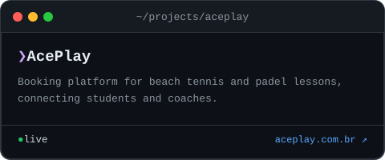</picture></a>
  <a href="https://github.com/GuilhermeLambrecht/Lumen"><picture><source media="(prefers-color-scheme: dark)" srcset="https://raw.githubusercontent.com/GuilhermeLambrecht/GuilhermeLambrecht/output/project-4-en-dark.svg" /><source media="(prefers-color-scheme: light)" srcset="https://raw.githubusercontent.com/GuilhermeLambrecht/GuilhermeLambrecht/output/project-4-en-light.svg" />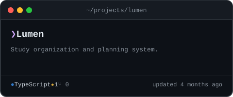</picture></a>
  <picture><source media="(prefers-color-scheme: dark)" srcset="https://raw.githubusercontent.com/GuilhermeLambrecht/GuilhermeLambrecht/output/project-2-en-dark.svg" /><source media="(prefers-color-scheme: light)" srcset="https://raw.githubusercontent.com/GuilhermeLambrecht/GuilhermeLambrecht/output/project-2-en-light.svg" />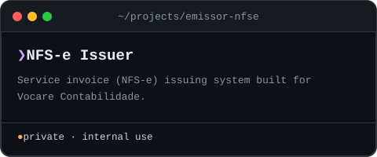</picture>
  <picture><source media="(prefers-color-scheme: dark)" srcset="https://raw.githubusercontent.com/GuilhermeLambrecht/GuilhermeLambrecht/output/project-3-en-dark.svg" /><source media="(prefers-color-scheme: light)" srcset="https://raw.githubusercontent.com/GuilhermeLambrecht/GuilhermeLambrecht/output/project-3-en-light.svg" />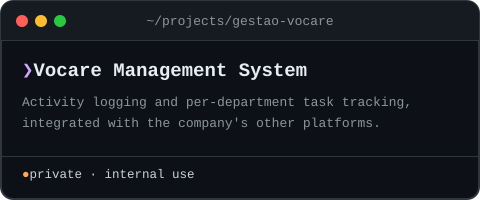</picture>
</p>

<br/>

<!-- ============ 04. stack() ============ -->

<p align="center">
  
</p>

<p align="center"><sub>+ Oracle Cloud · integrating AI models into internal systems and business processes</sub></p>

<br/>

<!-- ============ 05. learning() ============ -->


```yaml
architecture: project structure, separation of concerns and design patterns
scalability:  how systems handle growth in users, data and teams
quality:      maintainability, testing and readability
education:    Systems Analysis and Development — UniSenac (3rd semester, in progress)
```

<br/>

<!-- ============ 06. stats() ============ -->

<p align="center">
  <picture><source media="(prefers-color-scheme: dark)" srcset="https://raw.githubusercontent.com/GuilhermeLambrecht/GuilhermeLambrecht/output/stats-en-dark.svg" /><source media="(prefers-color-scheme: light)" srcset="https://raw.githubusercontent.com/GuilhermeLambrecht/GuilhermeLambrecht/output/stats-en-light.svg" /></picture>
  <picture><source media="(prefers-color-scheme: dark)" srcset="https://raw.githubusercontent.com/GuilhermeLambrecht/GuilhermeLambrecht/output/langs-en-dark.svg" /><source media="(prefers-color-scheme: light)" srcset="https://raw.githubusercontent.com/GuilhermeLambrecht/GuilhermeLambrecht/output/langs-en-light.svg" /></picture>
</p>

<br/>

<!-- ============ 07. contributions() ============ -->

<picture>
  <source media="(prefers-color-scheme: dark)" srcset="https://raw.githubusercontent.com/GuilhermeLambrecht/GuilhermeLambrecht/output/contrib-en-dark.svg" />
  <source media="(prefers-color-scheme: light)" srcset="https://raw.githubusercontent.com/GuilhermeLambrecht/GuilhermeLambrecht/output/contrib-en-light.svg" />
  
</picture>

<br/>
<br/>

<!-- ============ 08. contact() ============ -->

<p align="center">Open to opportunities, collaborations and conversations about technology.</p>

<p align="center">
  <a href="https://www.linkedin.com/in/guilhermelambrecht/"></a>
  <a href="mailto:guilhermelambrecht@gmail.com"></a>
  <a href="https://www.lambrecht.com.br"></a>
</p>

<!-- ============ git commit ============ -->
<p align="center">
  
</p>
