<!-- ============ $ whoami ============ -->
<p align="center">
  
</p>

<p align="center">
  <a href="https://www.linkedin.com/in/guilhermelambrecht/"></a>
  <a href="https://www.lambrecht.com.br"></a>
  
  
  
</p>

<p align="center">
  🇧🇷 Português · <a href="README.en.md">🇺🇸 English</a>
</p>

<br/>

<!-- ============ 01. sobre_mim() ============ -->



[;%3E+Automatizando+processos+com+IA+%F0%9F%A4%96;%3E+git+commit+-m+%22feito+pra+durar%22)](https://git.io/typing-svg)

<div align="justify">

Sou desenvolvedor fullstack com foco no ecossistema `TypeScript` (Node.js, NestJS, React e Next.js) e em `Python` para automação e processamento de documentos. Atuo na **Vocare Contabilidade**, onde desenvolvo os sistemas internos da empresa, integro plataformas de terceiros e aplico **inteligência artificial** para automatizar rotinas operacionais.

Estou cursando **Análise e Desenvolvimento de Sistemas** no UniSenac e hoje dedico meus estudos a **arquitetura de software** e **escalabilidade**. Busco entender não só como fazer um sistema funcionar, mas como fazê-lo durar.

</div>

```diff
+ Construindo sistemas de gestão, integrações e automações com IA
+ Processando documentos fiscais (XML, PDF e SPED) com Python
+ Aberto a oportunidades remotas e internacionais
- Sistema que só funciona (a meta é que dure)
```

<br clear="right"/>
<br/>

<!-- ============ 02. experiencia() ============ -->


**Desenvolvedor Fullstack** · Vocare Contabilidade · Pelotas, RS

- Desenvolvimento e manutenção do sistema de gestão interno, com registro de atividades e controle de tarefas por setor
- Desenvolvimento do emissor de NFS-e da empresa
- Integração entre o sistema interno e plataformas externas
- Aplicações em Python para processar documentos fiscais (XML, PDF e SPED)
- Preparação da hospedagem do sistema na Oracle Cloud
- Aplicação de IA para automatizar processos operacionais do escritório

<br/>

<!-- ============ 03. projetos() ============ -->


<p align="center">
  <a href="https://aceplay.com.br"><picture><source media="(prefers-color-scheme: dark)" srcset="https://raw.githubusercontent.com/GuilhermeLambrecht/GuilhermeLambrecht/output/project-1-pt-dark.svg" /><source media="(prefers-color-scheme: light)" srcset="https://raw.githubusercontent.com/GuilhermeLambrecht/GuilhermeLambrecht/output/project-1-pt-light.svg" />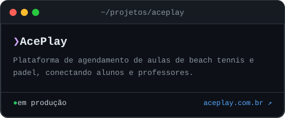</picture></a>
  <a href="https://github.com/GuilhermeLambrecht/Lumen"><picture><source media="(prefers-color-scheme: dark)" srcset="https://raw.githubusercontent.com/GuilhermeLambrecht/GuilhermeLambrecht/output/project-4-pt-dark.svg" /><source media="(prefers-color-scheme: light)" srcset="https://raw.githubusercontent.com/GuilhermeLambrecht/GuilhermeLambrecht/output/project-4-pt-light.svg" />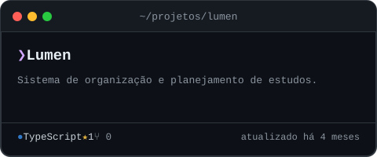</picture></a>
  <picture><source media="(prefers-color-scheme: dark)" srcset="https://raw.githubusercontent.com/GuilhermeLambrecht/GuilhermeLambrecht/output/project-2-pt-dark.svg" /><source media="(prefers-color-scheme: light)" srcset="https://raw.githubusercontent.com/GuilhermeLambrecht/GuilhermeLambrecht/output/project-2-pt-light.svg" />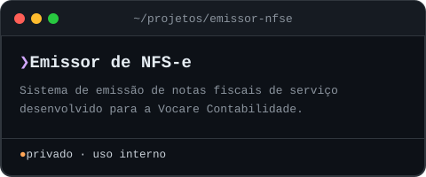</picture>
  <picture><source media="(prefers-color-scheme: dark)" srcset="https://raw.githubusercontent.com/GuilhermeLambrecht/GuilhermeLambrecht/output/project-3-pt-dark.svg" /><source media="(prefers-color-scheme: light)" srcset="https://raw.githubusercontent.com/GuilhermeLambrecht/GuilhermeLambrecht/output/project-3-pt-light.svg" />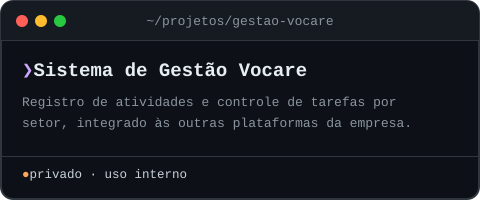</picture>
</p>

<br/>

<!-- ============ 04. stack() ============ -->


<p align="center">
  
</p>

<p align="center"><sub>+ Oracle Cloud · integração de modelos de IA em sistemas e processos internos</sub></p>

<br/>

<!-- ============ 05. estudando() ============ -->


```yaml
arquitetura:    organização de projetos, separação de responsabilidades e padrões de design
escalabilidade: como sistemas suportam crescimento de usuários, dados e equipes
qualidade:      manutenibilidade, testes e legibilidade
formacao:       Análise e Desenvolvimento de Sistemas — UniSenac (3º semestre, em andamento)
```

<br/>

<!-- ============ 06. estatisticas() ============ -->

<p align="center">
  <picture><source media="(prefers-color-scheme: dark)" srcset="https://raw.githubusercontent.com/GuilhermeLambrecht/GuilhermeLambrecht/output/stats-pt-dark.svg" /><source media="(prefers-color-scheme: light)" srcset="https://raw.githubusercontent.com/GuilhermeLambrecht/GuilhermeLambrecht/output/stats-pt-light.svg" /></picture>
  <picture><source media="(prefers-color-scheme: dark)" srcset="https://raw.githubusercontent.com/GuilhermeLambrecht/GuilhermeLambrecht/output/langs-pt-dark.svg" /><source media="(prefers-color-scheme: light)" srcset="https://raw.githubusercontent.com/GuilhermeLambrecht/GuilhermeLambrecht/output/langs-pt-light.svg" /></picture>
</p>

<br/>

<!-- ============ 07. contribuicoes() ============ -->

<picture>
  <source media="(prefers-color-scheme: dark)" srcset="https://raw.githubusercontent.com/GuilhermeLambrecht/GuilhermeLambrecht/output/contrib-pt-dark.svg" />
  <source media="(prefers-color-scheme: light)" srcset="https://raw.githubusercontent.com/GuilhermeLambrecht/GuilhermeLambrecht/output/contrib-pt-light.svg" />
  
</picture>

<br/>
<br/>

<!-- ============ 08. contato() ============ -->

<p align="center">Aberto a oportunidades, parcerias e conversas sobre tecnologia.</p>

<p align="center">
  <a href="https://www.linkedin.com/in/guilhermelambrecht/"></a>
  <a href="mailto:guilhermelambrecht@gmail.com"></a>
  <a href="https://www.lambrecht.com.br"></a>
</p>

<!-- ============ git commit ============ -->
<p align="center">
  
</p>
